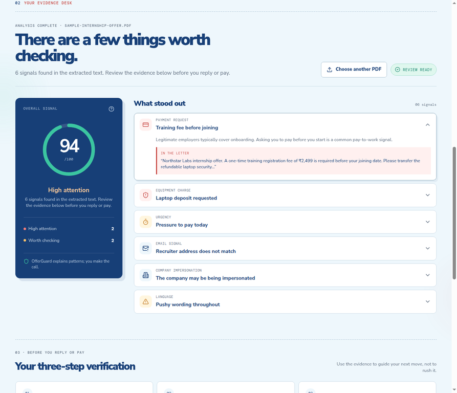

# OfferGuard

> **Spot the red flags before you say yes.**

OfferGuard is a privacy-first, browser-based tool that helps students and early-career applicants review internship and job offer letters. Instead of returning a black-box “fake” or “safe” label, it connects suspicious clauses to understandable risk signals and practical verification steps.

[](https://offerguard-8t5xupJuNvpsrCwaVXkHRp.manus.space/)
[](https://react.dev/)
[](https://www.typescriptlang.org/)

## Project Overview

OfferGuard lets a user select a PDF offer letter and analyze it directly in the browser. PDF.js extracts selectable text, deterministic heuristics identify explainable patterns, and the interface presents a risk score, highlighted excerpts, signal descriptions, and a three-step verification checklist.

The experience is designed as a calm “evidence desk” rather than an alarmist verdict generator. The uploaded PDF itself is not stored by the application. Completed analysis metadata can survive a normal refresh in the current browser tab through session storage and is cleared when the user starts a new check.

## Problem Statement

Students and job seekers increasingly receive polished-looking internship and employment offers through email and messaging platforms. Scam offers often use believable company names and professional formatting while asking candidates to pay training fees, deposits, processing charges, or other “refundable” costs.

Many existing checkers stop at a generic safe/fake label. That does not help a user understand what triggered the warning or what to verify next. OfferGuard solves this by making the evidence visible:

1. **Trace the clause** that triggered a warning.
2. **Understand the pattern** behind the warning.
3. **Choose a safe verification action** before replying or paying.

## Key Features

- **Browser-based PDF analysis** using PDF.js.
- **Immediate scan screen** after PDF selection while extraction continues asynchronously.
- **Parallel page extraction** for faster multi-page PDF processing.
- **Explainable signal detection** for:
  - Training, registration, processing, and onboarding fees.
  - Laptop, equipment, kit, and security deposits.
  - Urgency and pressure to act immediately.
  - Free-mail recruiter addresses such as Gmail, Yahoo, Outlook, and Hotmail.
  - Possible company impersonation or missing verification details.
  - Pushy or isolating language.
- **Evidence-first results dashboard** with a score, signal counts, descriptions, and excerpts from the letter.
- **Unreadable-file handling** that shows an honest message instead of inventing a verdict for image-only or encrypted PDFs.
- **Interactive evidence map** with animated nodes, signal-line highlighting, hover states, focus states, and click interactions.
- **Animated full-page experience** across the hero, upload panel, scan progress, findings, checklist, educational cards, and footer.
- **Built-in sample offer** for a quick product walkthrough without uploading a personal document.
- **Three-step verification checklist** for independently checking the recruiter, company, and payment request.
- **Refresh persistence** for completed results in the current tab without retaining the original PDF.
- **Visible “Choose another PDF” control** after analysis.
- **Responsive editorial interface** for desktop and mobile widths.
- **Reduced-motion accessibility fallback** through `prefers-reduced-motion`.

## Tech Stack

### Frontend

- React 19
- TypeScript
- Vite
- Tailwind CSS 4 and CSS custom properties
- Lucide React icons
- PDF.js (`pdfjs-dist`) for in-browser PDF text extraction

### Runtime and tooling

- Node.js
- pnpm
- Express/Vite project runtime
- Vitest for tests
- TypeScript compiler for static checks
- Static Vite build output in `dist/public`

OfferGuard’s current product flow is frontend-first and stateless. The repository also retains the starter project’s server, database, and shared infrastructure for future product stages, but the PDF analysis experience does not require an account, database, or backend API.

## Screenshots

### Upload experience and animated evidence map


### Evidence desk results



## Installation & Setup

### Prerequisites

- Node.js 20 or newer is recommended.
- pnpm 10 is used by the project lockfile and package configuration.

### Run locally

```bash
git clone https://github.com/Aneesh-Acharya17/offerguard.git
cd offerguard
pnpm install --frozen-lockfile
pnpm dev:static
```

Open the local URL shown by Vite, normally `http://localhost:3000`.

### Useful commands

```bash
# Run the frontend development server
pnpm dev:static

# TypeScript validation
pnpm check

# Build the static production output
pnpm build:static

# Run the repository test suite
pnpm test

# Build the full project runtime when working on server features
pnpm build
pnpm start
```

The static production build is written to `dist/public` and includes the application entry point and PDF.js worker asset.

## Project Structure

```text
offerguard/
├── client/
│   ├── index.html                 # Document shell and metadata
│   └── src/
│       ├── App.tsx                # Application route/provider entry
│       ├── index.css              # OfferGuard layout, theme, and animations
│       ├── main.tsx               # React bootstrap
│       └── pages/
│           └── Home.tsx           # Upload flow, PDF extraction, analysis, and UI
├── docs/
│   └── screenshots/               # README and project screenshots
├── public/
│   └── manus-routes.json          # Published route manifest
├── server/                        # Starter runtime and future server capabilities
├── shared/                        # Shared types and constants
├── drizzle/                       # Starter database schema and migrations
├── app.config.ts                  # Project metadata and logo configuration
├── plan.md                        # Approved implementation and design plan
├── TODO.md                        # Delivered outcomes and regression notes
├── package.json                   # Scripts and dependencies
├── pnpm-lock.yaml                 # Locked dependency versions
└── README.md                      # Project documentation
```

## Live Demo

[Open the OfferGuard live demo](https://offerguard-8t5xupJuNvpsrCwaVXkHRp.manus.space/)

The live demo is a public static deployment of the OfferGuard prototype. You can use the built-in sample offer to explore the evidence-map interaction and results dashboard without uploading a personal PDF.

## Contributors

- **Aneesh Acharya** — Product owner, project direction, OfferGuard concept, testing, and documentation.
- **Manus** — Implementation support, frontend engineering, PDF analysis workflow, interaction design, validation, and GitHub delivery.

Contributions, feedback, and ideas for safer student-facing workflows are welcome through GitHub issues or pull requests.

## License

No explicit open-source license has been added to this repository yet. Until a `LICENSE` file is added, the project remains under the repository owner’s default copyright and should not be redistributed or reused as licensed software without permission.

## Privacy and Limitations

OfferGuard is an evidence and education tool, not a definitive fraud detector. It can miss new scam patterns or flag a legitimate offer for further checking. Always verify the recruiter and company through official channels, and never pay a fee or deposit simply to obtain a job or internship.

PDF extraction currently works with selectable text. Scanned image PDFs and encrypted PDFs may require OCR or a different source document before they can be analyzed.
